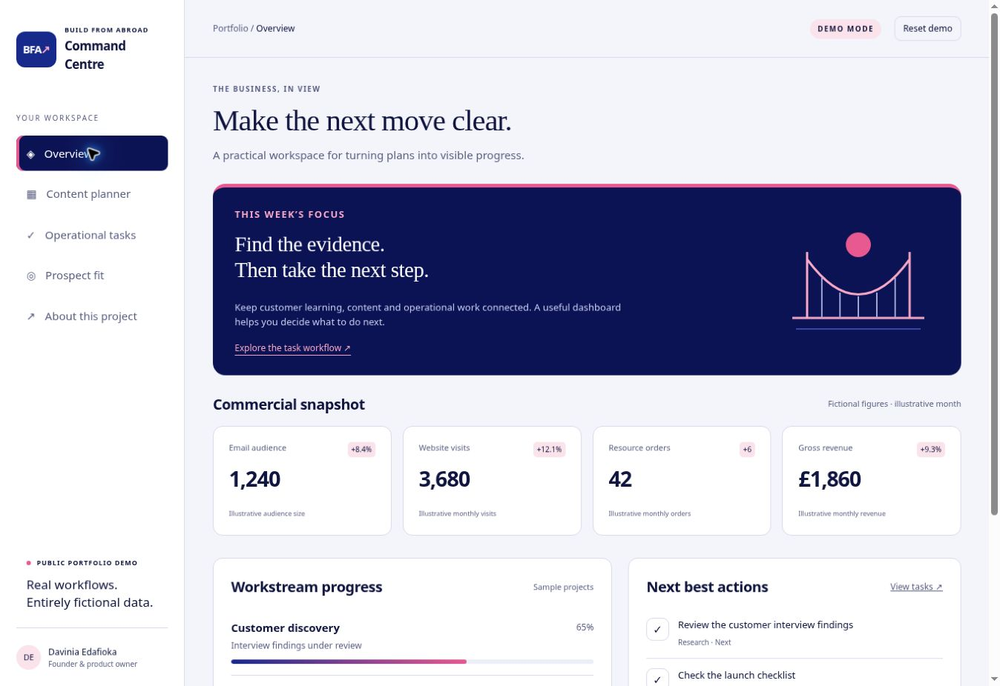

# Command Centre
### A founder-led business operations dashboard by Davinia Edafioka

Command Centre brings business workstreams, content review and operational tasks into one workspace. This public portfolio edition demonstrates how Davinia translated day-to-day business needs into a working tool through AI-assisted development.



**This is a standalone demonstration, not the private production application. All metrics, tasks, posts and prospects in the demo are fictional.**

Davinia uses the private Command Centre in her daily and weekly business routines. This showcase demonstrates a selection of those workflows.\n\n## Try it

Open **START-HERE.html** in a modern browser. It is self-contained, with no installation, account or internet connection required. Download the file first if your file viewer does not run JavaScript.

Alternatively, serve the `docs` directory:

```sh
python3 -m http.server 8000 --directory docs
```

Then open `http://localhost:8000`.

Try completing an overview task, adding and moving a task, filtering the content calendar, marking a sample draft ready, or changing a prospect score and pressing Apply. Refresh to retain changes in the same browser. Reset demo restores the fictional examples. Browser storage availability varies, especially for downloaded local files; changes can still be used within a session.

## The problem and design response

A founder's operating information is often scattered across task lists, publishing calendars and reporting tools. Command Centre organises that work around decisions: what is progressing, what needs attention and what happens next.

| Workflow | What visitors can try |
| --- | --- |
| Overview | Illustrative metrics and task progress that updates as demo work is completed |
| Content planner | A week grouped by day, channel filtering and Draft/Ready status changes |
| Operational tasks | Add a task, assign its workstream and move it between Next, In progress and Done |
| Prospect fit | Edit fictional scores, apply them and filter the resulting classifications |
| About | Read the case study, technology choices and demo limitations |

## Davinia's role

Davinia Edafioka is the founder and product owner. She defined requirements, business priorities and operating rules, reviewed outputs and directed iterative development with AI assistance. The portfolio demonstrates that product and workflow work; it does not claim that every line was manually written by Davinia or that the fictional metrics are achieved business results.

## Relationship to the original

The private Command Centre uses React, TypeScript, Vinext, Cloudflare Workers, D1 and R2, with integration and operational features. Publishing that full application would expose business-specific content and introduce unnecessary setup requirements.

This edition uses an independently built static interface and synthetic fixtures. Two reviewed production modules are retained unchanged in `src/`:

- `calendar-days.ts`: groups calendar dates and preserves channel/content identity when combining daily cards.
- `targeting-fit.ts`: classifies supplied scores and applies consistent filters.

`docs/app.js` uses calendar grouping and fit classification in the interactive demo. The additional calendar helpers remain available and tested. The rest of the production application, Git history, provider clients, live datasets and photographs are deliberately excluded.

## Architecture

- `docs/index.html`, `styles.css`: responsive, keyboard-accessible interface with system fonts and original CSS/SVG artwork.
- `docs/data.js`: newly written, fictional examples.
- `docs/app.js`: navigation, UI rendering and browser-local state.
- `src/`: selected original TypeScript business logic.
- `scripts/build.mjs`: compiles those modules using Node's built-in TypeScript stripping and builds the single-file demo.
- `tests/`: tests for date grouping, content identity, score boundaries and filters.
- `START-HERE.html`: generated self-contained demo.

No third-party runtime packages, analytics, tracking pixels, API calls, email sending or publishing capabilities are included. The supplied demo cannot connect to the private Command Centre.

## Development

Node.js 22.13 or newer is required only to rebuild or run tests. The TypeScript stripping API may show an experimental warning depending on Node version.

```sh
npm run build
npm test
```

No `npm install` is needed. Edit the files under `docs/` or `src/`, then rebuild `START-HERE.html`. Do not edit generated modules directly.

## Publish on GitHub

Suggested repository name: `command-centre-portfolio`.

Suggested description: `A founder-led business operations dashboard: content planning, task workflows and prospect-fit classification. Interactive demo with fictional data.`

Create a public repository and upload the extracted project files, not just the ZIP. GitHub Pages can serve the static `docs` directory. See `PUBLISHING.md` for the short checklist. No repository or public website was created as part of preparing this package.

## Validation

Six domain tests pass. Browser checks covered task completion, task creation and movement, persistence after refresh, draft approval, channel filtering, score application, classification filtering and reset. The overview was visually checked at desktop width and in a 390-pixel viewport. This is a portfolio demo, not a production security audit or cross-browser certification.

## Rights

Copyright 2026 Davinia Edafioka. All rights reserved. This repository is published for portfolio review. No open-source licence is granted. Build From Abroad branding is retained to identify the project. Contact the owner before reusing the code or branding beyond rights granted by the hosting platform and applicable law.
